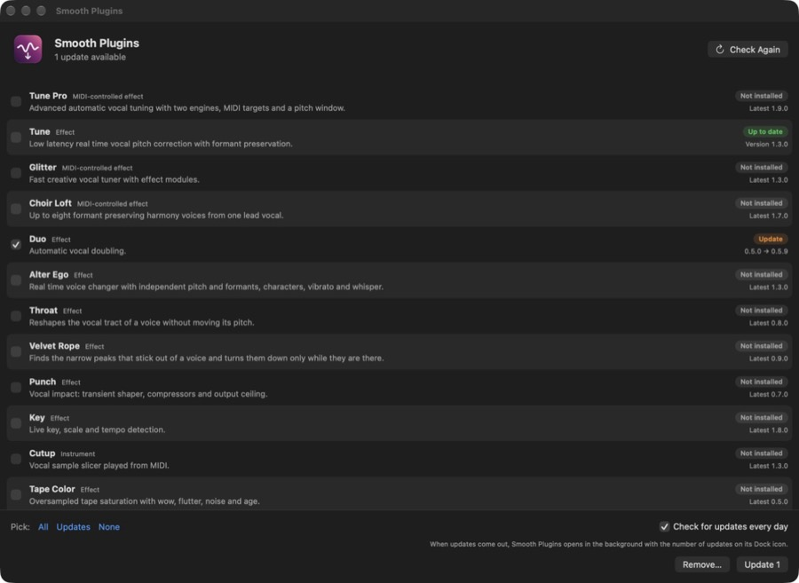
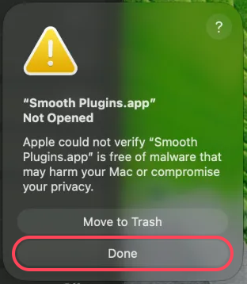
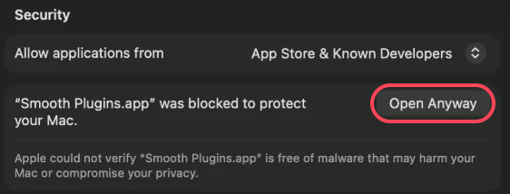
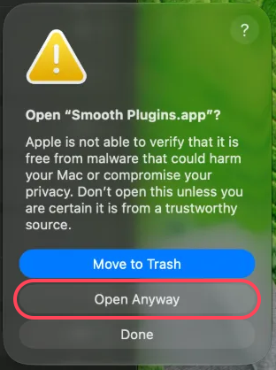
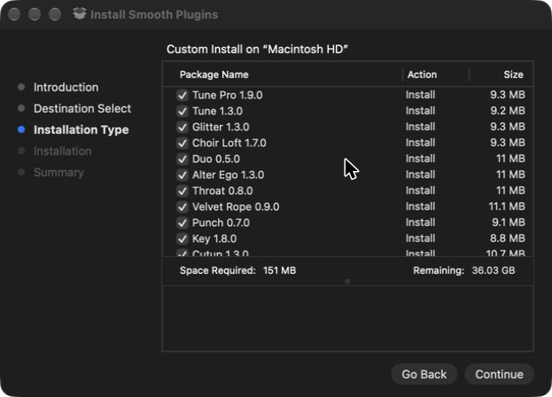

# Smooth Plugins

15 free Audio Unit plug-ins for Logic Pro, made mostly for vocals: tuning, doubling, harmonies, voice changing, tape effects and more. Free to use in any music, including releases you sell.

**[Download the Smooth Plugins app](https://github.com/coquetteluke/smooth-plugins/releases/latest/download/Smooth-Plugins-App.zip)** · [All releases](https://github.com/coquetteluke/smooth-plugins/releases)

## What you need

- A Mac with Apple Silicon (M1 or newer). Intel Macs are not supported.
- macOS 13 Ventura or newer.
- Logic Pro. They are standard Audio Units, so other AU hosts may work, but they were only tested in Logic.

## Install

The Smooth Plugins app installs the plug-ins you pick and keeps them up to date:



1. Download [Smooth-Plugins-App.zip](https://github.com/coquetteluke/smooth-plugins/releases/latest/download/Smooth-Plugins-App.zip), unzip it and drag **Smooth Plugins** into your Applications folder.
2. Open it. The first time, macOS blocks it with a warning: follow [Opening the app the first time](#opening-the-app-the-first-time) below (about 30 seconds, only once).
3. Tick the plug-ins you want and click **Install**.
4. Open Logic Pro. The plug-ins are under Audio Units > Luke Garito.

**Updates:** the app checks for updates once a day. When new versions come out, it opens in the background (it doesn't take you away from what you're doing) with the number of updates on its Dock icon. Click **Update** and restart Logic. You can turn the daily check off at the bottom of the app; untick it before deleting the app.

**Removing:** tick the plug-ins and click **Remove**. They go to the Trash.

If Logic lists a plug-in as failed, open Logic Pro > Settings > Plug-in Manager, select it and click Reset & Rescan Selection.

## Opening the app the first time

The first time you open Smooth Plugins, macOS blocks it and shows a warning. This is normal for free apps from outside the App Store, and you only do it once.

**Why it happens:** macOS only trusts an app straight away if its developer pays Apple $99 a year for a developer account and sends every version to Apple to be checked (Apple calls this notarizing). Smooth Plugins is free, and that fee isn't paid, so macOS can't vouch for it. The warning doesn't mean anything wrong was found in it: Apple just hasn't looked at it. All of the code is here on GitHub for anyone to read, and the app only downloads plug-ins from this page's releases and checks every file before installing it.

**How to open it:**

1. Double-click **Smooth Plugins**. macOS says it wasn't opened. Click **Done** (not Move to Trash).

   

2. Open **System Settings > Privacy & Security** and scroll down to **Security**. Next to "Smooth Plugins.app was blocked to protect your Mac", click **Open Anyway**. The button is there for about an hour after step 1; if it's gone, do step 1 again.

   

3. macOS asks one more time. Click **Open Anyway**, then enter your password or use Touch ID. Careful: the blue button here is **Move to Trash**, so don't just press Return.

   

From then on, Smooth Plugins opens normally. The plug-ins it installs don't need this step. A new version of the app (the app tells you when one is out) needs it once more.

On macOS 13 or 14 there's a shortcut: Control-click (or right-click) the app, choose **Open**, then click **Open** again.

The installer package shows the same warning, and the same steps open it.

<details>
<summary>Other ways to install: the installer package or the zip</summary>

**Installer package.** It has a checkbox for each plug-in, but it does not check for updates.



1. Download [Smooth-Plugins-Installer.pkg](https://github.com/coquetteluke/smooth-plugins/releases/latest/download/Smooth-Plugins-Installer.pkg) and double-click it.
2. macOS blocks it the first time: follow [Opening the app the first time](#opening-the-app-the-first-time), with the installer's name in place of the app's.
3. Click Continue, choose **Install for all users** or **Install for me only**, untick any plug-ins you don't want, and click Install.

**Zip, by hand.**

1. Download `Smooth-Plugins.zip` from the [latest release](https://github.com/coquetteluke/smooth-plugins/releases/latest) and unzip it.
2. In Finder, choose Go > Go to Folder, paste `~/Library/Audio/Plug-Ins/Components` and press Return.
3. Drag the `.component` files you want into that folder.
4. Open Terminal and run this once. macOS blocks plug-ins copied out of a downloaded zip until you do:

   ```bash
   xattr -dr com.apple.quarantine ~/Library/Audio/Plug-Ins/Components/*.component
   ```

The app also updates plug-ins installed either of these ways.

</details>

## The plug-ins

| Plug-in | Kind | What it does |
|---|---|---|
| [Tune Pro](tune-pro) | MIDI-controlled effect | Advanced automatic vocal tuning with two engines, MIDI targets and a pitch window |
| [Tune](tune) | Effect | Low latency real time vocal pitch correction with formant preservation |
| [Glitter](glitter) | MIDI-controlled effect | Fast creative vocal tuner with effect modules |
| [Choir Loft](choir-loft) | MIDI-controlled effect | Up to eight formant preserving harmony voices from one lead vocal |
| [Duo](duo) | Effect | Automatic vocal doubling |
| [Alter Ego](alter-ego) | Effect | Real time voice changer with independent pitch and formants, characters, vibrato and whisper |
| [Throat](throat) | Effect | Reshapes the vocal tract of a voice without moving its pitch |
| [Velvet Rope](velvet-rope) | Effect | Finds the narrow peaks that stick out of a voice and turns them down only while they are there |
| [Punch](punch) | Effect | Vocal impact: transient shaper, compressors and output ceiling |
| [Key](key) | Effect | Live key, scale and tempo detection |
| [Cutup](cutup) | Instrument | Vocal sample slicer played from MIDI |
| [Tape Color](tape-color) | Effect | Oversampled tape saturation with wow, flutter, noise and age |
| [Tape Chorus](tape-chorus) | Effect | Tape style chorus with 1 to 8 voices, feedback, wow, flutter and saturation |
| [Tape Flanger](tape-flanger) | Effect | Through-zero tape style flanger |
| [Switchboard](switchboard) | Effect | Put it on Stereo Out to see and set the controls of these plug-ins on every track from one window |

Each folder has its own README with every control, the presets and the changelog.

**Switchboard and the link:** each plug-in writes a small file describing its controls to `~/Library/Application Support/SmoothPlugins/link/`, so Switchboard can find it. Nothing is sent over the internet.

## Build from source

You need the Xcode command line tools and CMake 3.22 or newer. Each plug-in builds on its own, and JUCE 8.0.10 is downloaded the first time you configure one:

```bash
cmake -S duo -B duo/build
```

```bash
cmake --build duo/build --target InstallAU -j 8
```

`InstallAU` builds the plug-in, signs it for your Mac and copies it into `~/Library/Audio/Plug-Ins/Components`. Swap `duo` for any other folder. To use a JUCE checkout you already have, add `-DJUCE_DIR=/path/to/JUCE` to the first command.

To build the Smooth Plugins app, run `updater/build-app.sh <output folder>`. To make every release file (app, installer, zips and the `manifest.json` the app reads) from a folder of built `.component` files, run `release/make-release-assets.sh <folder> <release tag> <output folder>`.

The tests' voice recordings are not in this repo, because they were made with the macOS text to speech voices, which Apple does not allow redistributing. Run `tests/make_corpus.sh` inside a plug-in's folder to make them on your own Mac. Tests that compare against saved renders from earlier versions will report those files missing.

## License

The code is licensed under the [GNU AGPL v3](LICENSE), the open source license of JUCE 8, which these plug-ins are built on. The fonts are under the SIL Open Font License 1.1; see [third-party/FONTS.md](third-party/FONTS.md).
