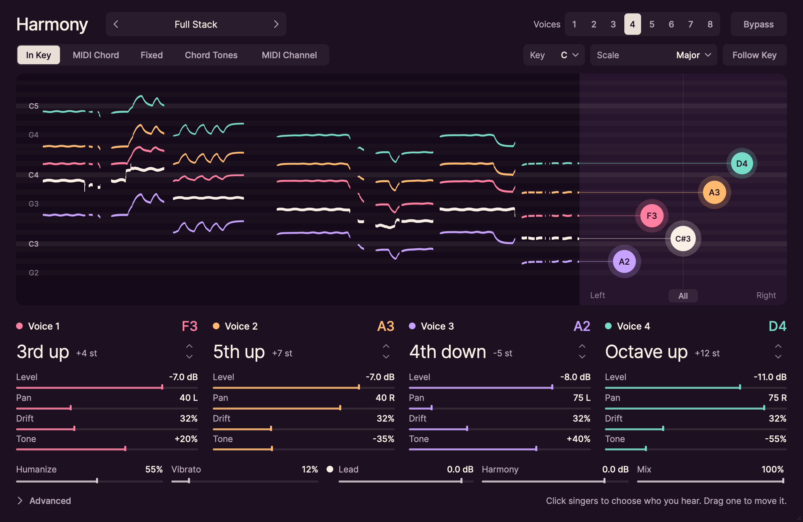
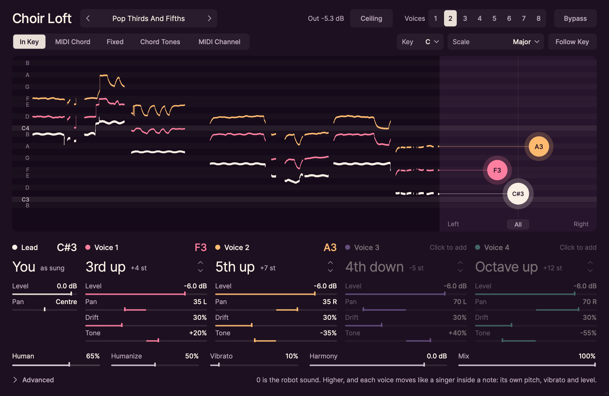

# Choir Loft

Up to eight harmony voices from one lead vocal. Formants stay where they are, so the voices sound like people and not like a sped up tape. Each voice has its own timing, pitch, throat, tone, breath and consonants, so together they aim to sound like separate singers. The Tight preset turns all of that off and sits exactly on the notes. Human (1.5.0) goes from the robot sound at 0, which is the default and the sound of every earlier version, to voices that move the way a singer does.

**Load it:** Audio Units > Luke Garito > Choir Loft. AU code `aumf SHrm Luke`. It takes MIDI and goes in an audio effect slot. Mono, stereo, and mono in with stereo out. With mono in, the voices still spread across the stereo field.

Most of what is here was measured on synthetic voices and macOS `say`. That does not prove it sounds good on a real singer. 1.4.2 and 1.5.0 to 1.6.1 were also measured on Luke's own dry takes (`realvox/`, and "Low notes and Human" below). Luke heard 1.0.0 on his voice, liked it, and found it robotic. 1.1.0 goes after that, but nobody has heard 1.1.0 yet, and the numbers below only show the causes moved. `demo/` has before and after files.

## First settings to try

- Scale Interval, your song's Key and Scale, Voices 2. That is the default: a third and a fifth above, 6 dB under the lead.
- Too loose? Pull Humanize and Drift down together, or load Tight for the exact 1.0.0 style tuning.
- MIDI Choir preset, then hold chords on the track's MIDI. Voices sing the chord, lead stays on top.

## Controls

Every control is a real AU parameter that a host can find by name.

| Control | What it does |
|---|---|
| Mode | Where voice pitch comes from. See below. |
| Key, Scale | Used by Scale Interval. Chromatic, Major, Minor, Harmonic Minor, Melodic Minor, Major Pentatonic, Minor Pentatonic, Blues, Dorian, Mixolydian. |
| Follow Key | Takes key and scale from `~/Library/Application Support/SmoothPlugins/key.json`, written by Smooth Key, on a background thread. Missing, broken, stale (over 10 minutes old), future dated or low confidence (under 0.5) data is ignored: the last good key holds, and with none it uses Key and Scale. A Manual or Locked key from Key is followed the same way. Picking a Key or Scale by hand in the window turns Follow Key off. With it on, the window says where the key came from and how long ago Key wrote it (1.6.0). In an offline bounce or freeze the file is read every 0.3 s of audio rather than of wall time, so a key change lands at the same place in the song as in playback (1.6.0). |
| Voices | 1 to 4. Voices fade in and out. |
| More Voices | 0 to 4, added to Voices: Voices 4 and More Voices 4 is eight singers. Two controls because a host stores automation of Voices as a position in its range, and widening that range would have moved old automation. The window shows them as one row, 1 to 8. |
| Voice N On, Lead On | Whether you hear that singer. Off fades over 15 ms, and it stops using CPU while its note logic keeps going, so it comes back on the right note. Voices 1 to 8. |
| Voice N Interval | -24 to +24 semitones. Its value string says both: `+4 st (3rd up)`. Fixed Interval uses the semitones. Scale Interval uses the name, so +3 and +4 both mean a third, and the scale decides its size. In the window the arrows step to the next name in a seven note key, and one semitone in any other key and in Chord Tones, where every semitone can sing another note (1.6.0). |
| Voice N Level | -60 (Off) to +6 dB. |
| Voice N Pan | Constant power, centre at unity. Full left is +3 dB left, nothing right. |
| Voice N Drift | 0 to 100%. Slow pitch, timing and level wander, plus small grain to grain roughness. 100 is +/-20 cents, up to 40 ms behind the lead and about +/-1.5 dB. Each voice wanders on its own. |
| Voice N Throat | 70 to 140%. Above 100 lowers that voice's formants, as a longer throat would. Defaults differ per voice, about 20% between the extremes. |
| Voice N Tone | -100 to +100%. Darker or brighter, for good: a shelf at 1.6 kHz. Defaults differ per voice. |
| Humanize | How a person differs from a machine, note by note. A scoop from below (up to 70 cents, less when coming down), a slow settle (up to 18 cents), landing a little off the note (up to 8 cents at random plus up to 5 cents of the voice's own habit), standing behind the lead (up to 26 ms by voice plus up to 18 ms per note), a slower glide, a softer start to a phrase, its own vibrato depth and timing. Above 0 it also turns on period blending and high end unevenness. 0 is exact. |
| Human | 0 to 100%. 0, the default, is the robot sound: the plug-in as it was before 1.5.0, with nothing of this running. Above 0 each voice moves the way a singer does: a wander and a flutter of its own inside every note (random, not a steady wobble), a small part of your own movement on the note, a vibrato whose speed and depth no longer hold still, a level of its own instead of an exact copy of yours, and its own moment of letting go at the end of each note. It never moves a voice off its note on average, and since 1.5.4 never takes a voice more than 40 cents from its note. Humanize is the note by note character (scoops, landing off the note, standing behind the lead). Human is what happens inside the note. They work together or apart. |
| Vibrato | 0 to 100%, up to +/-60 cents. Starts 180 ms into a note. Each voice's rate is slightly different. |
| Vibrato Rate | 3 to 8 Hz. Voice 1 runs at this, the others up to 7% away. |
| Lead Level | -60 (Off) to +6 dB. |
| Lead Pan | Same law as voice pan. |
| Harmony Level | -60 (Off) to +12 dB, all voices together. |
| Mix | 0 is the delayed dry input, 100 is lead plus voices. |
| Glide | 0 to 500 ms between notes, as a time constant. |
| Follow Lead | 0 to 100%. In modes with a set note, how much of the lead's own pitch wander the voices copy. 0 sits on the note. Fixed Interval always copies all of it. With Humanize, some voices copy less than others. |
| Consonants | 0 to 100%. How much of the lead's unvoiced sound each voice carries. Those sounds are never pitch shifted. |
| Consonant Scatter | 0 to 100%. 0 passes a copy of the lead's consonant at the voice's lag. Above 0 each voice makes its own: a scatter of short random delays so it shares no waveform with the others, later (about 50 ms at most on top of the lag, by voice and by consonant), softer, and at a level picked per consonant. A long stretch without pitch is taken as a breath and fades out, since real singers do not all breathe together. |
| Breath | 0 to 100%. Noise of each voice's own, following that voice's high end. 100 is about 7 dB under the voice above 3 kHz. |
| Chord Root, Chord Type | Used by Chord Tones. |
| Chord Hold | Keeps a MIDI chord after the keys are up, until the next new note. The sustain pedal works too. |
| Input Type | Voice range. Sets tracking range and latency. Soprano 150 Hz to 1.3 kHz, Alto/Tenor 98 Hz to 1 kHz, Low Male 65 to 600 Hz, Wide Range 65 Hz to 1.3 kHz. Since 1.5.0 Alto/Tenor also follows notes under its range, down to 65 Hz, at the same latency: see "Low notes and Human". |
| Tracking | Which sounds count as pitched. 0 is choosy, 100 lets rough, breathy sound count. |
| Reference A4 | 415 to 466 Hz. |
| Bypass | Keeps the same delay. |
| Ceiling | Off or on, off by default (1.5.2). On, what comes out never passes -0.3 dBFS: one gain for both channels comes down at once when a sample would pass a soft knee, holds for 30 ms and comes back over 200 ms. No look ahead, so no added delay. A take with room to spare is not touched, and Bypass still passes the vocal untouched. Switched on or off while it is holding the level down, it fades over 20 ms instead of stepping (1.6.0). |

Readings, which never write automation: Detected Pitch, Lead Note, Voice 1 to 8 Note, Voices Sounding, Active Key. An off singer reads no note and does not count as sounding. The window draws from them live. Hosts read them by name.

## The window

The top half shows what each voice sings and where it sits. On the left, each voice is a line through the last 8 seconds, the lead in warm white. Each line runs into its singer on the stage on the right.

- **Up and down** is the note, the same scale on both sides. Rows are the notes of your key, stronger on the root.
- **Left and right on the stage** is pan.
- **A singer's size** is its Level. The pale ring around it swells with how loud it is right now. A hollow ring means its Level is Off.
- **The thickness of a line** is how loud that moment was.
- **With nothing playing,** singers show where they would sit, so you can set up the voices before you sing.

**Click a singer to hear it or not,** on the stage or by its name on its card, so you can hear any 1, 2, 3 or more together. The lead works the same way, so you can hear only harmonies. Off singers and their lines dim. All, under the stage, brings everyone back.

Drag a singer: left and right pans it, up and down changes its interval. In the MIDI modes MIDI decides the note, so a drag only pans. A click with no movement switches, a drag moves. Two quick clicks are off and on again, so a double-click on a singer does not reset it. Double-click its controls for that.

Below the display, the row of cards starts with the lead: its name and switch, the note you are singing, Level and Pan. Then each voice has a card with its note, its interval in words, Level, Pan, Drift and Tone. Up to 4 voices there are 4 wide cards, with the spare ones dimmed. Above that there is a card per singer in narrower columns, so all of them stay in view. Under those are Human, Humanize and Vibrato, which say how the voices sing, then Harmony and Mix. Advanced holds Throat, Vibrato Rate, Glide, Follow Lead, Breath, Consonants, Scatter, Voice range, Tracking and Reference A4. When Advanced opens, the display gets shorter instead of the window getting bigger.

The Mode row says In Key where the parameter is called Scale Interval, and Fixed where it is Fixed Interval. Key and Scale swap with Chord and Type in Chord Tones mode, and Follow Key swaps with Chord Hold in the MIDI modes. Whichever pair is not by the display is in Advanced, so every control always has a place.

In the top row, between the presets and the voice count, are the Ceiling switch and the output's loudest moment in words ("Out -3.0 dB"). From -1 dBFS up the words turn warm white and say "near full scale", above 0 "over full scale"; they hold for a second and a half and go out when nothing plays (1.5.2).

With Follow Key on, the space in the Mode row left of Key says whose key is in use: "From Key, 4 min ago", or "Waiting for Key, using this key" before Key has written one (1.6.0). Since a test run once moved Luke's key without him seeing it, a key from Key is never a silent change. Pan and Tone bars fill from their middle (1.6.0). A window saved at a size taller than the screen it opens on shrinks to fit it, with room for Logic's own header (1.6.0).

Every control is a real parameter with the same ID, name and range as before. Double-click resets, click a value to type it, the arrows on an interval step to the next interval, and Shift gives a finer drag. The size and whether Advanced is open are saved with the session, and nothing else was added to saved state. The line under the controls explains whatever is under the mouse.

`src/editor/`: `StageView` is the display, `Controls` the controls, `HarmonyEditor` the layout, `Theme` the colours. Font: Inter, SIL OFL, license in `assets/fonts/`. Pictures are in `docs/window/`: `build/RenderWindow_artefacts/Release/RenderWindow docs/window` draws them again from the `say` recordings in `tests/corpus`, which are not a singer.

The display reads a pitch and level history and never touches the sound. Two small additions feed it: the audio thread keeps the loudest sample of the lead and of each voice over each 5 ms and stores it in lock-free history. The `window` tests compare a bit for bit fingerprint of the output on 5 presets against the 1.1.0 source, with no window and with the window open and drawing. All are identical.

CPU, real window at 2x on this Mac: every run is in `docs/window-cpu.md`. `tests/AuViewCheck.mm` opens the installed window through the system 80 times, with and without audio.

## Modes

- **Scale Interval:** the lead's nearest scale note, then the Interval counted in scale steps. In C major a third on C is E, a major third, and a third on E is G, a minor third. In scales without seven notes it takes the scale note nearest that many semitones.
- **MIDI Chord:** held notes set the voices. No notes, no voices, and the lead passes exactly. More notes than voices: lowest and highest stay, then the newest. Fewer: spare voices rest. A held note keeps its voice, and on a change voices move the least in total. A note over two octaves from the lead moves by octaves to within reach.
- **Fixed Interval:** the lead's pitch plus the Interval in semitones, whatever the key.
- **Chord Tones:** the note of the set chord (Chord Root and Type) nearest lead plus Interval, no MIDI needed.
- **MIDI Channel:** voice N sings the newest note on MIDI channel N.

## Presets

Pop Thirds And Fifths, Third Above, Third Below, Full Stack, Gang Unison, Wide Octaves, Power Fifths, MIDI Choir, MIDI Chords Only (lead off), Chord Tones Pad, Tight. Six Part Stack, Eight Part Choir, MIDI Eight Part Choir. Human Thirds And Fifths (1.6.0): Pop Thirds And Fifths with Human at 65. Presets never change Key, Scale, Follow Key or Input Type. They leave Human alone too, so the robot or human choice stays as you set it while you try presets, with two exceptions: Tight puts Human at 0, because it promises exact tuning, and Human Thirds And Fifths puts it at 65, because showing Human is what it is for. They all put every singer back on.

The session remembers which preset was chosen (1.6.0), only to name it: its values are in the session anyway and are not applied again. A session saved before 1.6.0, or one where no preset was chosen, opens saying "Choose a preset", and the arrows then go to the first and the last one.

Tight is exact tuning: no Drift, Humanize, Vibrato, Tone, Breath or Scatter, Throat 100, Follow Lead 0, Consonants 35. It meets the 1.0.0 limits. It is not a bit for bit copy of 1.0.0, because the vowel end fix below applies everywhere. For the 1.0.0 default sound itself, set Drift 25, Humanize 20, Vibrato 10, Throat 100, 96, 104, 92, Glide 20, Follow Lead 25, Consonants 35, Tone, Breath and Scatter 0.

## Level with many voices

Voices add level, and until 1.5.2 nothing held the output under full scale. Since 1.5.2 there is Ceiling, off by default (see Controls and "The leak, the note ends and the ceiling"), and the window says when the output is within 1 dB of full scale whether Ceiling is on or not. Up to 4 voices nothing changes. Above 4, the voices together turn down so 8 stay about as loud as 4, which is what unrelated voices add up to: -1.0 dB at 5, -1.8 at 6, -2.4 at 7, -3.0 at 8. Voices 5 to 8 also start 3 dB lower than the first four, at -9 dB, and the new presets turn the lead down a little.

On a vocal peaking at -6 dBFS, measured output peaks: two voices at defaults 0.64, Voices set to 8 at defaults 0.80, Six Part Stack 0.55, Eight Part Choir 0.48, MIDI Eight Part Choir 0.59. A vocal peaking near full scale can still pass 0 dBFS, as it could before. Turning singers off does not turn the rest up.

## Signal flow

Input > clean bad samples > history > pitch tracker (on left and right mixed) > note logic on a 1 ms tick > up to eight grain voices reading the shared mono history, each with its own consonant path > per voice all-pass, level match, Tone, Breath, fade, Level, Pan > summed with the delay matched lead > Mix > Bypass > output.

- `src/PitchTracker.h`: from Smooth Tune. Since 1.5.0 it can follow notes under its range without the range getting slower: where the range's own window finds nothing periodic, or while a low note is being followed, it also looks at the longer periods over a longer window, which reaches further back in time and adds no delay. Since 1.4.1 a start must also repeat in its even harmonics. Since 1.4.2 it must also repeat once its formants are taken out by linear prediction, unless plainly periodic, and reports how far back the start reaches so voices can be written back to it. Changes: marks slide much more slowly towards the loudest part of each period, because that slide bent shifted pitch by up to 8.6 cents. Since 1.4.0, once a note is under way, a move to two or three times the current period must also hold over three windows, so breathy sound no longer drops it an octave or a twelfth for a few ms.
- `src/VoiceShifter.h`: pitch-synchronous grains, one input period of window each side of a mark, spaced at the wanted output period. Timing lag comes from choosing an older period, so it cannot bend pitch. Unvoiced sound is read straight at one held offset, so it is the input at a lag, with no grain spacing on it. A slight reading speed change cancels the formant drag at large shifts. With Humanize above 0, a grain reads between two neighbouring periods instead of repeating or dropping whole ones, and where it reads is nudged at random per grain, so the high end stops repeating exactly while pitch stays put.
- `src/HarmonyBrain.h`: the modes, Glide, Follow Lead, and each voice's drift, vibrato and humanize. `HumanVoice` there is the Human control: random numbers of its own, so at 0 nothing else changes. Each voice hears the lead late by its own lag, so its note changes come late by themselves. Since 1.4.0 a start is a phrase after silence, pitch coming back after 10 ms or more without it, or a reattack. In a start's first 50 ms plus the voice's lag, and after a note held under 80 ms, notes change without a glide; glides are for legato notes. While the lead rises out of a start, the voices bend with it. `src/MidiChord.h`: held notes and voice assignment. `src/Scales.h`: scales, chords, intervals. `src/KeyFollower.h`: the key file.
- `src/PluginProcessor.cpp`: parameters, latency, MIDI timing, the mix. Since 1.4.0: the first 30 ms of pitch of each stretch are rewritten with the newest reading; a reattack is the lead 9 dB louder than 20 to 30 ms before; the level match reads faster for 60 ms after a start. MIDI waits for the latency, so a chord change lines up with the lead. Pitch from the tracker is looked up in a short history for the same reason, and so is voicing, per voice: a voice keeps singing until the end of a vowel it is reading, not until the tracker has seen the vowel end, which in 1.0.0 cut each vowel short and left its last moments at the lead's pitch.
- `getReadings()` and `getPitchPoint()` give a later window everything without touching audio.

## Phrase starts (1.4.0)

Luke heard 1.3.1 miss vocal starts on his own vocals. `tests/OnsetTests.h` makes the starts a singer makes, at every Input Type and three pitches in its range, with the two default voices on their own channels: 432 voice starts per preset. A voice has sounded once it is within 50 cents of its note and within 3 dB of its own steady level against the lead, held 20 ms. Limits are in `tests/PassLimits.h`, committed before 1.3.1 was measured on them (commit d336daf).

| Kind of start | Default 1.3.1 | Default 1.4.0 | Tight 1.3.1 | Tight 1.4.0 |
|---|---|---|---|---|
| Hard start | 4 wrong, 148 ms | 0, 26 ms | 4, 82 ms | 0, 28 ms |
| Soft start | 6, 108 ms | 0, on time | 6, 64 ms | 0, on time |
| Scoop of 2 semitones | 20, 77 ms | 0, 8 ms | 14, 18 ms | 0, on time |
| Breathy start | 18, 288 ms | 2, 74 ms | 14, 168 ms | 0, 76 ms |
| Creaky start | 12, 133 ms | 0, 17 ms | 9, 88 ms | 0, 18 ms |
| s into the vowel | 4, 115 ms | 0, 24 ms | 3, 76 ms | 0, 30 ms |
| t into the vowel | 4, 146 ms | 0, 26 ms | 4, 82 ms | 0, 28 ms |
| Vibrato at once | 5, 129 ms | 0, 22 ms | 6, 82 ms | 1, 26 ms |
| After a 100 ms gap | 4, 145 ms | 0, 19 ms | 4, 82 ms | 0, 20 ms |
| Room reverb | 28, 148 ms | 0, 27 ms | 26, 134 ms | 0, 28 ms |
| Bright take | 2, 50 ms | 0, 19 ms | 2, 38 ms | 0, 26 ms |
| All 17 kinds | 115 wrong | 2 wrong | 100 wrong | 1 wrong |

Each cell: voices that sang another note first, then the 95th percentile time to sound past the voice's own lag (limit 40 ms). m and l into the vowel and first notes of 150 ms were already fine. Humanize 0: 111 wrong to 0, worst kind 252 to 73 ms. No voice skipped a first note of 150 ms or longer, before or after.

The `say` corpus, every voiced stretch of 150 ms or longer: every voice sounds in all 58, median 21 ms past the lag (1.3.1: 21 ms). Its 90th percentile went from 37 to 57 ms, because voices now bend with a rising start, and `say` speech rises a lot; a bent voice is not counted until it sits within 50 cents of a scale note.

1.4.1: a start must also repeat in its even harmonics (the sound plus itself half a period later), which a lone formant's ring does not. Breaths through a closed vowel no longer sing; the worst breath, through an open vowel, sings 29.8% of the time, longest 70 ms (1.4.0: 54.5%, 190 ms). Wrong first notes at the default: 2 to 1. Hard starts 95th percentile 26 to 17 ms. `say` median 21.7 ms. An open vowel's two formants ring like the 2nd and 3rd harmonics of a note between them, and only a 30 ms periodicity check told them apart; it made starts after a consonant or breath 10 to 18 ms later, so it was left out.

1.4.2: a start must also repeat once its formants are taken out (linear prediction, then whether what is left repeats a period later), unless the sound is plainly periodic or has stayed clean for 10 ms. A start is written back to where nearly periodic sound began, so voices standing behind the lead still come in on time. Breaths, s, sh, noise and room tone: 0 singing (limit 1%). Wrong first notes 0 at every preset tested. On Luke's held out takes breath leak fell from 12.0% to 3.1% and starts came in sooner, with 1 and 4 more wrong first notes at phrase and word starts. Breathy high starts still come in 67 to 72 ms late against 40: the aspiration matches the voice for its first 50 ms.

Still failing in 1.4.0 (fixed in 1.5.1, see "Breathy high starts, the creak and the doubler"): breathy starts on high notes, where the aspiration noise goes through the vowel's own formants and the tracker reads an octave high for about 50 ms (74 to 76 ms against 40). Breaths through a closed vowel at -30 dBFS make a voice sing 54.5% of the time against a limit of 1%, longest 190 ms (1.3.1: 55.1%, 190 ms): a narrow formant rings like a note. Two fixes were tried and dropped: a check that a start repeats at twice its period (it delayed `say` starts, median 22 to 34 ms) and whitening the tracker's input (`say` starts slower, 2 of 58 missed).

`PluginTest onsets`, `PluginTest notrigger`; `PluginTest onsettrace`, `trackertrace` and `corpustrace` print one start frame by frame.

## Low notes and Human (1.5.0)

Luke, on 1.4.4: "it misses low notes a lot and the voices sound robotic like really robotic. i mean i like the robotic sound but i also want a more human option". Both were measured on 11 of his own dry takes (Rode NT1, whole songs, 2247 voice seconds of pitched singing) with `realvox/RealVox.cpp`, whose checks and pass rules were committed before any change was measured (commits 1f8e91e and 772d144). Six more takes were kept blind and run once at the end, after 1.5.0 was committed: those numbers are in `~/smooth-plugins/_vox/rode/work/harmony/REPORT.md`.

### Low notes

Alto/Tenor, the default Input Type, tracked from 98 Hz. Luke's low notes sit at 91 to 97 Hz, just under it. Every held note of each take (200 ms or more on one pitch), each voice, default settings:

| Lead pitch | Voice notes | 1.4.4 sang them | 1.5.0 | Time on the note, 1.4.4 | 1.5.0 |
|---|---|---|---|---|---|
| under 98 Hz | 28 | 6 (12 missed, 8 dropped out part way, 2 on another note) | 28 | 42.0% | 87.5% |
| 98 to 130 Hz | 700 | 697 | 700 | 95.7% | 95.7% |
| 130 Hz and up | 2630 | 2623 | 2621 | 94.4% | 94.4% |

Time on the note is under 100% even when nothing is wrong, because a voice gliding between two notes is on neither. All 22 misses under 98 Hz had one cause: the note was under the range (the tracker found no period in 20 of them and too rough a one in 2). Above 98 Hz nothing stood out: 10 of 3330 voice notes failed in 1.4.4 and 9 in 1.5.0, and where a voice was off its note the tracker was right 72 to 87% of the time, which is the glide.

The fix keeps the latency at 13.7 ms. A tracker's delay is how far ahead it looks, not how long its window is, so the range's own window is untouched and decides how fast a start is called, exactly as before. Only where that window finds nothing periodic, or while a low note is already being followed, does the tracker also look at periods from 98 Hz down to 65 Hz, over a window as long as the longest of them, which reaches about 10 ms further back. A voice on such a note reads up to a period later than it otherwise would. That is the voice's lag, of which the default voices have 5 to 25 ms anyway, not the plug-in's delay. Under the range the tracker is choosier, so fry and the creak at the end of a word, which before 1.5.0 never sang, still mostly do not: a start there needs half the usual limit.

What it costs: on held notes above 98 Hz, two late notes (a voice reaching its note 110 and 120 ms after the lead; 1.4.4 had none). Octave errors 5 (1.4.4: 6), share of time an octave off 0.63% (0.64%). Phrase and word starts: the medians did not move (22, 24 and 22 ms with Humanize and Drift at 0, where nothing is random). A little more breath and creak sings, since some of it repeats at 65 to 98 Hz: with Humanize and Drift at 0, voices sing through 12.24% of breath frames (1.4.4: 12.12%) and through 3.76% of the unpitched frames inside phrases (3.56%); starts after a consonant, 90th percentile 28 ms (24); breathy starts, median 20 ms (18). The dropout share fell from 2.17% to 1.48%. Widening the whole range to 65 Hz at the same latency was built and measured too: it gets 91.8% under 98 Hz, and moved those three medians one 2 ms step later each, so it was not used. Wide Range and Low Male, which need 20.6 ms, get 91.7% and 92.1%.

### The robot sound, and what was measured to be robotic about it

At the default settings, against Luke himself on the same notes, and against Luke singing the same part twice in one take (19 held notes where a line comes round again, the nearest thing to a real double):

| What | Voices, 1.4.4 | Luke, or his two passes | |
|---|---|---|---|
| Pitch spread inside a held note | 5.3 cents | 20.1 cents | 3.8 times stiller |
| of it slower than 150 ms | 2.3 cents | 12.5 cents | 5.4 times |
| of it faster | 4.3 cents | 11.1 cents | 2.6 times |
| Strongest steady wobble | 5.2 cents at 5.0 Hz, the built in vibrato | 15.9 cents at 3.5 Hz | a different, fixed rate |
| Level curve inside a note against the lead's, how alike | 0.81 | 0.13 between his two passes | a copy of his level |
| Two voices' movement in common | 0.42 | 0.12 between his two passes | they move as a block |
| Interval between the two voices, spread inside a note | 6.1 cents | 25.7 between his two passes | 4 times tighter |
| Ends of the two voices apart | 4 ms | 40 ms between his two passes (11 ends) | together |
| Starts of the two voices apart | 6 ms | 14 ms (2 starts only) | nearly together |
| Note average off its note | 4.5 cents | 16.7 between his two passes, 26.5 off his own note | far more exact |
| Note changes, 10 to 90% | 70 ms | 76 ms | the same: not a cause |
| Spectrum shape against the lead | voice 1 2% up, voice 2 8% down | 0.1% between his two passes | not one throat: not a cause |
| S sounds, two voices alike | 0.19 (1 is a copy) | | not copies: not a cause |

So the robot is, in order: pitch held still inside a note with one steady wobble on it; a level that copies the lead's; the voices moving as one block; the voices ending and starting together. Instant note changes, one throat and copied consonants, which were suspects, are not it.

### Human

One control, 0 to 100%, 0 by default. At 0 none of it runs. Above 0, for each voice, from its own random numbers: a wander (turning over a few times a second) and a flutter in pitch that ease in as each note lands, a little of the lead's own movement on the note (smoothed, a different amount per voice, and not how far off the note the lead is), a vibrato whose rate and depth drift, a level that keeps part of its own through the lead's quick swells and dips plus a small wander, and a small shift per note in how far behind the lead the voice stands. Note changes, throat and consonants are left as they are.

Its limits were written into `realvox/RealVox.cpp` before it existed (U1 to U9: in tune, not sloppy, starts no later, held notes no worse), with four numbers for what more human had to mean at 100 (V1 to V4). The working set:

| | Human 0 | 35 | 65 | 100 | Limit | Luke |
|---|---|---|---|---|---|---|
| Pitch spread inside a note, cents | 5.3 | 6.2 | 8.0 | 10.4 | no more than Luke's (U3); 10 or more at 100 (V1) | 20.2 |
| Two voices' movement in common | 0.40 | 0.37 | 0.35 | 0.32 | 0.30 or less at 100 (V2) | 0.12 |
| Interval between the voices, spread, cents | 6.1 | 7.3 | 9.5 | 12.2 | 15 at most (U4) | 25.7 |
| Note average off its note, cents | 4.6 | 5.0 | 6.6 | 7.8 | 10 at most (U1) | 16.7 |
| Level curve like the lead's | 0.82 | 0.78 | 0.74 | 0.64 | 0.65 or less at 100 (V3) | 0.13 |
| Level against the lead, spread, dB | 0.71 | 0.74 | 0.80 | 0.88 | 1.21 at most (U8) | 1.21 |
| Voice 1 and voice 2 start after the lead, ms | 46 and 53 | 46 and 53 | 46 and 53 | 46 and 53 | 60 at most each (U5) | |
| Both, 90th percentile, ms | 73 | 72 | 73 | 74 | 80 at most (U5) | |
| Ends of the two voices apart, ms | 4 | 3 | 4 | 4 | 8 or more at 100 (V4), 40 at most (U7) | 40 |
| Note changes, 10 to 90%, ms | 68 | 68 | 68 | 68 | 120 at most (U6) | 76 |

Every limit U1 to U8 holds at 35, 65 and 100. U9, held notes no worse than at Human 0, holds at 65 and 100; at 35 one of its seven rules fails, the share of held notes sung right from 98 to 130 Hz, 0.9971 against 1.0000 with 0.002 allowed: 2 of 700 voice notes (take 02 at 29.7 s, take 04 at 12.4 s) were read an octave off for 55 and 30 ms. The first was traced: the voice was on its note there and the tool's pitch reading had picked a ripple, so this looks like the measure and not the voice, but the rule stands as written and it failed.

Of the four numbers for "more human" at 100, two were reached (pitch spread 10.4 cents against 10, level curves 0.64 against 0.65) and two were not: the two voices still move together 0.32 against 0.30, and their ends are still 4 ms apart against 8. A voice ends when the lead's own note dies away; letting a voice go early was built, made voices miss notes (88 of 3358), and was taken out. So at 100 Human moves a voice a third of the way from the robot to Luke in pitch movement (5.3 to 10.4 cents, Luke 20.2), a quarter of the way in level (0.82 to 0.64, his two passes 0.13), and not at all in when it starts and stops.

### What else changed in the sound, and the proof that nothing more did

1.5.0 changes the sound with Human at 0 in two places, both on purpose. Alto/Tenor sings notes under 98 Hz. And a click is gone: at a start, a voice's own copy of the consonant before the note used to jump to the note's new place behind the lead while it was still fading out (Humanize draws that place per note), a step in what it reads. Of the 40 clicks the shared tool listed on Luke's takes at 1.4.4's defaults, 2 were this; the other 38 are clicks and creaky pulses in the takes themselves, sung back by a voice 5 to 60 ms later, which is the voice doing its job. The copy now stays where it was from the start until it has faded, about 5 ms.

The proof that nothing else moved: the 1.5.0 source with just those two changes left out renders all 11 working takes bit for bit as 1.4.4 does, at the default, at Full Stack and at Tight (`RealVox hash`, 33 renders, 33 the same). So the Human control at 0, the new parameter and everything else add nothing. With the two changes in, against 1.4.4, Human at 0:

- Soprano, Low Male and Wide Range, and any take that never goes under 98 Hz: only the click fix differs. Wide Range on the 11 takes: the difference is 40 to 55 dB under the render, the largest single sample -29 dBFS.
- Alto/Tenor (the default, and every preset, since presets leave Input Type alone): the same file as 1.4.4 up to the first moment the tracker follows something under 98 Hz, which is 0.5 to 23.5 s into these takes (with the low note fix alone built in; with the click fix as well, the first voice start differs by the 40 to 55 dB above). From that moment the file is a different one for the rest of the take, 1.6 to 2.2 dB under the render itself, as different as two passes of the same voices. Two reasons, neither a change in what the voices do. A voice is rebuilt from grains set at its own pitch pulses, and once it has sung one thing differently its pulses fall at other instants from then on: the same note and the same sound, not the same samples (with Humanize and Drift at 0 the difference is still 2.7 to 5.5 dB under the render). And each voice draws its note by note choices (how far behind the lead, how it lands) from one run of random numbers, so one more sung note moves every later choice along by one. That it is the same sound is what the measures say: every robot number above reads the same on 1.4.4 and on 1.5.0 at Human 0 (pitch spread 5.3 and 5.3 cents, level curve 0.81 and 0.82, voices together 0.42 and 0.40, voice 1 starting 46 ms after the lead on both and voice 2 52 and 53 ms), and above 130 Hz the held note table sits beside 1.4.4 measured against itself with the take slid by 21 and 42 ms: time on the note 94.41%, where 1.4.4 reads 94.38%, 94.46% and 94.40%; notes sung right 99.66%, where 1.4.4 reads 99.73%, 99.73% and 99.69%, the two late notes.

The 22 null tests in `tests/` pin the sound on a synthetic voice. The low note fix and Human at 0 left all 22 as they were. The click fix changed 4 of the 5 and 11 of the 12 presets they cover (Tight has no Humanize, so nothing moved there); those now pin 1.5.0 at Human 0.

### Before or after a doubler

Luke runs Duo before Choir Loft. Takes 02, 10 and 12 were put through the installed Duo, and through Tune Pro alone, then into Choir Loft at its defaults, and judged against the notes of the dry take:

| Into Choir Loft | Under 98 Hz, sung of 28 | 98 to 130 Hz, of 262 | 130 Hz and up, of 896 | Time on the note, the three bands | Octave errors |
|---|---|---|---|---|---|
| 1.4.4, dry | 6 | 259 | 895 | 40.6%, 96.9%, 94.1% | 2 |
| 1.4.4, Duo first | 4 | 257 | 889 | 38.6%, 93.6%, 91.6% | 8 |
| 1.4.4, Tune Pro first | 6 | 256 | 896 | 36.5%, 95.0%, 92.7% | 0 |
| 1.5.0, dry | 28 | 262 | 893 | 90.7%, 96.8%, 94.2% | 2 |
| 1.5.0, Duo first | 28 | 259 | 879 | 86.5%, 93.8%, 91.4% | 14 |
| 1.5.0, Tune Pro first | 28 | 260 | 895 | 85.6%, 94.9%, 92.7% | 3 |

A doubled lead costs the voices about 3 points of time on the note in every band and brings octave errors, in both versions: two copies of the voice a few ms and cents apart do not repeat cleanly. 1.5.0 behind Duo reads an octave low more often than 1.4.4 does (13 voice notes above 130 Hz against 7). Choir Loft was not tuned for a doubled lead. It does better placed before Duo.

### Level

Two voices at -6 dB on top of the lead add 1.76 dB of power, and the takes read +1.75 to +1.84 dB while Luke sings. Peaks rise more where a voice's pulse lands on the lead's: +1.8 to +4.5 dB at the default on these takes (1.4.4: +1.4 to +4.5; take 05, the hottest: dry -7.7 dBFS, out -3.2 in both), +3.4 to +6.2 dB on Full Stack (1.4.4: +2.9 to +6.5; take 05: -1.5 dBFS, 1.4.4 -1.2). There is no limiter, so a lead that peaks above about -4.5 dBFS can pass 0 dBFS at the default, and one above about -6.5 can on Full Stack. This is as designed, and 1.5.0 does not change it.

## Breathy high starts, the creak and the doubler (1.5.1)

Luke, on 1.5.0's report: "This is not good enough. I need 100% and I need zero failures." 1.5.1 is the second pass: the three tests that had failed since 1.4.0 pass, the octave low behind a doubler is fixed, and Human at 100 reaches three of its four goals. The suite is at 616 pass, 0 fail. Latency is unchanged at every Input Type.

### Breathy high starts

Time for a voice to sound on its note past its own lag, 95th percentile, breathy starts (the worst kind), limit 40 ms:

| | default | Tight | default, Humanize 0 |
|---|---|---|---|
| 1.4.0 to 1.5.0 | 67.9 ms | 72.0 ms | 67.1 ms |
| 1.5.1 | 38.7 ms | 36.0 ms | 33.3 ms |

Voices singing another note first stays 0 of 432 at all three, and breaths, s, sh, noise and room tone still make no voice sing (0.000 of the time). What was wrong, found frame by frame (`PluginTest trackertrace 4 3 69 500 620` and `onsettrace`), was four things:

1. The period. The breath in a breathy start has gone through the same formants as the voice, so it rings at them for a few ms. On a high note the period is that short, and the difference function at one period then measures the ring as much as the voice: on the A4 start at Wide Range, half a period, one period and three periods read 0.27, 0.27 and 0.12. The tracker took half (an octave high), refused it as a start because its even harmonics do not repeat, waited, then took three periods (147 Hz for a 440 Hz note) and came right 76 ms after the lead was on its note. Now, until a note is established, its period is the shortest of the deep dips and their halves, thirds and quarters that a voice could have (`startPeriod` in `src/PitchTracker.h`): its even harmonics repeat, which half a true period fails outright; every deep dip is a whole number of it; and it reads about as well as the deep dip it came from. That start is now called 48 ms sooner, on 440 Hz.
2. The reading. Each period's mark is matched against the noisy period before it, and the period read 4% either way from one period to the next (565 to 632 Hz on a 587 Hz note), which moved the voices to the next note and back. When a note with a period under 5 ms is still breathy 10 ms in, for its first 80 ms the period given out is the coarse one averaged over 10 ms and refined at a lag of 8 ms or more, and the marks keep to it. It reads 578 to 592 Hz.
3. The voice. With pitch and marks right, a voice still read 660 to 737 Hz against 698, because a grain cut from a lead that is half breath is half breath: by the test's own measure the lead itself is not within 50 cents of its note until 46 ms in. During such a start each grain is now the mean of three periods (`steady` in `src/VoiceShifter.h`), which keeps what repeats and leaves a third of the breath's power. This is a change you can hear: for the first 80 ms of a breathy start above 200 Hz the voices carry less breath than the lead.
4. A note just called does not drop to two, three or four of its periods while its own period still holds.

A clean start is called on its period a few ms sooner than before, where the old rule sat on a passing harmonic first, so the 22 null tests now pin 1.5.1 at Human 0 (every preset moved, Tight too).

### The creak, and the doubler in front

The end of a word often drops into a creak an octave down, 70 to 77 Hz on Luke's takes and clean. Since 1.5.0 Alto/Tenor follows it, which is right. Two things went wrong after it:

- Behind Duo the creak runs straight into the next word, whose pulses stay uneven for 30 to 40 ms, and 1.5.0 left the low period only when the half period read within 0.015 of it. The next word's start was sung an octave low. Now a followed low note gives way as soon as the range has a clean note at half its period (a difference under 0.15 at full rate, even harmonics repeating). A real low note of Luke's reads 0.4 or more at half its period the whole note through. Test: `PluginTest aftercreak` (`tests/AfterCreak.h`), 20 ms at most; 1.5.0's tracker on the same signal reads an octave low for 42 ms at 140 Hz and 47 ms at 165 Hz, 1.5.1 for 0 and 8 ms.
- On the dry takes the voices glided up an octave out of the creak, and two held notes were reached 110 and 120 ms late. A jump up of a sixth or more out of a note under the range is now a new start, taken at once.

Takes 02, 10 and 12, Choir Loft at its defaults, judged against the dry take's notes:

| Into Choir Loft | Above 130 Hz, sung right of 896 | Octave errors above 130 Hz | Under 98 Hz, of 28 |
|---|---|---|---|
| 1.4.4, Duo first | 889 | 7 | 4 |
| 1.5.0, Duo first | 879 | 13 | 28 |
| 1.5.1, Duo first | 890 | 4 | 28 |
| 1.5.1, dry | 895 | 1 | 28 |
| 1.5.1, Tune Pro first | 895 | 1 | 28 |

Duo in front still costs about 3 points of time on the note (86.0%, 93.7% and 91.6% in the three bands against 90.0%, 96.7% and 94.2% dry), so Choir Loft still does better before it.

### The 11 working takes, 1.5.1 against 1.5.0 and 1.4.4

Held notes at the default: under 98 Hz 28 of 28 (time on the note 86.6%, 1.5.0 87.5%, 1.4.4 42.0%); 98 to 130 Hz 699 of 700 (700, 697); above 130 Hz 2623 of 2630 (2621, 2623), late notes 0 (2, 0). The pass rule H1 to H10 against 1.4.4 holds in full. The point lost under 98 Hz is the price of the two rules for leaving and refusing a low note.

Starts and breaths with Humanize and Drift at 0, 1.5.1 / 1.5.0 / 1.4.4: wrong first notes at phrase starts 6 / 7 / 6; phrase starts median 22 / 22 / 22 ms; breath leak 12.19% / 12.24% / 12.12%; voices singing through unpitched frames inside phrases 4.27% / 3.76% / 3.56%; fry starts, 90th percentile 50 / 44 / 44 ms; breathy starts median 20 / 20 / 18 ms. The leak inside phrases is up half a point; 1.4.4 measured against itself with the take slid by 21 and 42 ms reads 4.09% and 4.23%, so it is at the edge of what this measure does by itself, and it is not better.

### Human at 100

| | 1.5.0 | 1.5.1 | Goal |
|---|---|---|---|
| Pitch spread inside a note, cents (V1) | 10.4 | 10.3 | 10 or more |
| Two voices' movement in common (V2) | 0.32 | 0.27 | 0.30 or less |
| Level curve like the lead's (V3) | 0.64 | 0.58 | 0.65 or less |
| Ends of the two voices apart, ms (V4) | 4 | 6 | 8 or more |

V2 is reached: the voices follow half as much of the lead as in 1.5.0 (what they take from the lead they take together), and each voice's vibrato runs at its own speed, up to a tenth off. V4 is not: 6 ms against 8. By the tool's measure a voice ends when the lead's note is called over, plus that voice's lag. Letting a voice fall behind over a long note, by up to 20 ms from 200 ms in, moved it from 4 to 6; 28 ms moved it no further and falling behind from 80 ms in cost time on the note. Level made no difference: 12 dB between the voices moved the ends by 2 ms. Every limit U1 to U9 holds at 35, 65 and 100 (1.5.0 failed U9 at 35): note average off its note 5.0, 5.9 and 7.8 cents against 10; interval spread 7.2, 10.0 and 13.1 against 15; starts 46 and 52, 46 and 52, 47 and 51 ms against 60; level spread 0.75, 0.84 and 0.95 dB against 1.21.

## The leak, the note ends and the ceiling (1.5.2)

Third pass, on Luke's bar ("I need 100% and I need zero failures"). What 1.5.1 made worse on his takes is back at 1.5.0 or better, Human at 100 reaches all four of its goals, and there is an output ceiling. The suite is at 663 pass, 0 fail. Latency unchanged.

### What 1.5.1 made worse, and where it is now

Working set (11 takes), 1.4.4 / 1.5.0 / 1.5.1 / 1.5.2:

| | 1.4.4 | 1.5.0 | 1.5.1 | 1.5.2 |
|---|---|---|---|---|
| Voices singing through unpitched frames inside phrases, Humanize and Drift 0 | 3.56% | 3.76% | 4.27% | 3.76% |
| Tracker alone, ms voiced in the gaps between words | 151 | 156 | 161 | 156 |
| Time on the note under 98 Hz | 42.0% | 87.5% | 86.6% | 87.8% |
| Held notes under 98 Hz sung, of 28 | 6 | 28 | 28 | 28 |
| Behind Duo, octave errors (takes 02, 10, 12) | 8 | 14 | 5 | 4 |
| Breathy high start tests, ms (limit 40) | 67.9, 72.0, 67.1 | the same | 38.7, 36.0, 33.3 | 38.7, 36.0, 33.3 |

The leak was one kind of event: 1.5.1 let a start's period be twice the first deep dip and took it at once, so 5 ms of a murmur at -46 dBFS before a word was called a note (take 02 at 189.41 s) and the voices sang 30 ms of it. The longer period must now come out the same twice in a row while nothing is voiced. The lost time under 98 Hz was the refusal of low starts, which also refused a fresh start out of a creak; it now applies only within 100 ms of a followed low note's end.

### Chance in the measures, and a rule that can be decided

The start and breath measures move by themselves. One version against itself, with the take slid by 10, 21 or 42 ms or the plug-in's random choices reseeded, moves the leak inside phrases by up to 1.3 points at the default (0.7 with Humanize and Drift at 0), wrong first notes at phrase starts by 14 of 592 (4), the 90th percentile of fry phrase starts by 23 ms (16) and of breathy starts by 11 ms (10). The 1.4.2 rule allows 0.2 points and 2 ms, so a version fails it against itself (2 to 9 of its rules). It stays as written. Beside it, `realvox/decidable.py` asks each of the same 21 measures to be no worse than the reference by more than that measure's own noise (`realvox/NOISE-default.txt`, `NOISE-plain.txt`). By that rule 1.5.2 is no worse than 1.5.0 or 1.4.4 on any measure, at the default and with Humanize and Drift at 0, and a version passes against itself.

### Real breathy starts

Luke's 89 breathy starts on the working set are not what the breathy start test of 1.4.0 makes. His notes there sit at 155 Hz (half of them between 137 and 193), the way in is 30 ms of loud breath with no pitch, and the note is clean 20 ms after it begins, coming in 40 to 70 cents under. The old test is a note of up to 587 Hz with breath all through its first 80 ms. `PluginTest realstarts` is a start of his shape at 131, 165 and 196 Hz: 95th percentile time to sound past the lag -4.4 ms at the default, 12.8 ms at Tight, 4.1 ms with Humanize 0 (limit 40), no wrong first notes. On the takes themselves the tracker is on the right note 24 ms after the onset at the median and 45 ms at the 90th percentile for breathy starts (1.5.0 the same, 1.4.4 57), and the tool's own 90th percentile reads 46 ms with Humanize and Drift at 0 (1.5.0: 44, 1.4.4: 52), inside its noise of 10 ms. They did not get faster in 1.5.2.

### Human: each voice's own note end

| Human 100, working set | 1.5.0 | 1.5.1 | 1.5.2 | goal |
|---|---|---|---|---|
| Ends of the two voices apart, ms | 4 | 6 | 12 | 8 or more |
| Pitch spread inside a note, cents | 10.4 | 10.27 | 10.35 | 10 or more |
| The two voices' movement in common | 0.32 | 0.27 | 0.30 | 0.30 or less |
| Level curve like the lead's | 0.64 | 0.58 | 0.59 | 0.65 or less |

When the lead's note is over for a voice, the voice holds on for its own time on the lead's last periods and dies away over its own time, drawn per voice and per note and scaled by Human (voice 1 up to 5 and 10 ms, voice 2 up to 24 and 18 ms at 100). The hold is over at once when the lead is pitched again or about to be, so it does not run into the next note. U1 to U8 hold at 35, 65 and 100. U9, the held notes no worse than at Human 0, holds at 65 and 100 (at 100: 98 to 130 Hz 699 of 700, octave verdicts 5, both as at 0) and misses at 35 by one octave verdict in the final run (8 against 5, 7 allowed; the run before read 4): three short notes where the tool's reading of the voice's pitch flips for single frames at Human 0 as well and ran for 30 ms at 35. The margins are thin where the goals pull against each other: movement in common sits at its limit, and the suite's own limit on the interval between the voices (15 cents, 14.89 measured) caps how far the voices can move on their own.

### Ceiling

Off by default. On, no sample passes -0.3 dBFS, with no look ahead and no added delay. Lead peaking at -1 dBFS:

| | Ceiling off | Ceiling on | true peak, on |
|---|---|---|---|
| Default | +3.93 dBFS | -0.304 dBFS | -0.29 dBTP |
| Full Stack | +5.52 dBFS | -0.300 dBFS | -0.26 dBTP |

Inside a held note it is a steady gain (what it adds beside a plain turn down: -52 dB at the default, -44 dB on Full Stack). A lead at -19 dBFS comes out bit for bit the same with it on. Bypass with it on passes the vocal untouched. The window says when the output is within 1 dB of full scale, on or off.

### Not at zero

With Humanize and Drift at 0 on the working set, five measures read above the better of 1.4.4 and 1.5.0, each inside its noise, none traced to the plug-in: wrong first notes at phrase starts 8 (6, 7), fry phrase starts 90th percentile 50 ms (44), breathy starts 46 ms (44), starts after a consonant 26 ms (24), breath leak 12.19% (12.12). The validation on the Rode blind set and the first session's takes is in `~/smooth-plugins/_vox/rode/work/harmony/REPORT.md`.

## Human: what the two voices share (1.5.3)

Fourth pass, Human only; Human at 0 renders Luke's working takes bit for bit as 1.5.2 at every setting measured. Run with other random numbers (`REALVOX_SEED`, the take untouched), 1.5.2's movement in common at Human 100 read 0.30, 0.30, 0.34 and 0.27 on the working set: it sat on its limit and fell on either side by chance. What the two voices shared was the lead's own movement, copied by both through Follow Lead and through Human's own follow. Now each voice follows its own part of it: voice 1 (and every odd numbered voice) the slow part, voice 2 (and every even numbered one) the quick part. Follow Lead's copy is split that way by Human's amount, only within 18 cents of the note, so a slide from one note to the next is still copied whole and the bend out of a start is untouched. Voice 2 also keeps more of its own level through the lead's quick swells (0.6 of it at Human 100, was 0.3).

| Human 100 | 1.5.2 | 1.5.3 | goal |
|---|---|---|---|
| Movement in common, working set, four runs | 0.30, 0.30, 0.34, 0.27 | 0.27, 0.27, 0.29, 0.24 | 0.30 or less |
| Movement in common, the first session's takes | 0.21 | 0.18 | 0.30 or less |
| Level curve like the lead's, working set | 0.59 | 0.53 | 0.65 or less |
| Level curve like the lead's, the first session's takes | 0.68 | 0.61 | 0.65 or less |
| Pitch spread inside a note, working set | 10.35 | 10.47 | 10 or more |
| Ends of the two voices apart, working set | 12 ms | 12 ms | 8 or more |
| Level against the lead inside a note, spread | 0.95 dB | 1.02 dB | 1.21 at most |

U1 to U8 and U9 hold at 35, 65 and 100 on the working set (1.5.2 missed U9 at 35 by one octave verdict). U9's octave and late verdicts move with chance: with other random numbers 1.5.2 fails one of its rules at Human 100 in one run of four (9 octave verdicts against 5), 1.5.3 in two (8 octave verdicts against 5, and time on the note from 98 to 130 Hz 95.64% against 95.66% allowed); with the plug-in's own random numbers both pass. On the first session's takes, Human 100 still has 7 late notes against 3 at Human 0, as 1.5.2: voice 2, standing further back, lands 85 to 90 ms into three notes.

## Human: the held notes with any random numbers (1.5.4)

Fifth pass, Human only; Human at 0 renders Luke's working takes and the first session's takes bit for bit as 1.5.3. The held note rule for Human (U9: the held notes no worse than at Human 0, H3 to H9 of `realvox/RealVox.cpp`) held at Human 100 only with the plug-in's own random numbers. Run with other random numbers (`REALVOX_SEED` 0 to 7, the take untouched, each against Human 0 with the same seed):

| Human 100, working set, U9 | 1.5.3 | 1.5.4 |
|---|---|---|
| Runs with a rule failed, of 8 | 5 (H5, H7, H3, H8, H3) | 2 (H3; H3 and H7) |
| Time on note 98 to 130 Hz, against Human 0, worst run | 95.64% against 95.76% | 95.78% against 95.76%, above Human 0 on all 8 |
| Time on note from 130 Hz, against Human 0 | 94.38% to 94.45% against 94.43% to 94.47% | 94.55% to 94.61% against 94.43% to 94.47% |
| First session's takes, late notes (Human 0: 3, 5 allowed) | 7 | 3 |

Three things changed. Humanize's per note random choices (scoop, detune, glide, place behind the lead) are now the same at Human 100 as at Human 0 for the same take: a voice's attack and consonant timing are drawn where the lead's note starts and ends for it, not where Human's own note end moves the voice, which used to reshuffle every later choice. Human no longer moves a voice's place behind the lead (a shift per note, and up to 20 ms of falling behind over a long note, given back over the next note): a voice hears the lead through its lag, so a lag that drops just after a note change makes it late by the drop, which is how voice 2 landed 85 to 90 ms into four held notes of the first session. And Human's own wander never takes a voice more than 40 cents from its note, counting the glide still to go and Humanize's scoop, detune and vibrato. So a voice still moves as much: the wander comes back over 80 ms after a note starts (was 150) and each voice follows half as much again of your movement; voice 2 holds a note's end up to 34 ms (was 24) and voice 1 lets go at once.

| Human 100 | 1.5.3 | 1.5.4 | goal |
|---|---|---|---|
| Pitch spread inside a note, working set (seeds 0 to 3) | 10.47 | 10.92, 11.50, 10.98, 11.18 | 10 or more |
| Pitch spread inside a note, the first session's takes | 10.69 | 10.71 | 10 or more |
| Movement in common, working set (seeds 0 to 3) | 0.27, 0.27, 0.29, 0.24 | 0.28, 0.24, 0.24, 0.26 | 0.30 or less |
| Movement in common, the first session's takes | 0.18 | 0.23 | 0.30 or less |
| Level curve like the lead's, working set / first session | 0.53 / 0.61 | 0.51 to 0.52 / 0.62 | 0.65 or less |
| Ends of the two voices apart, working set / first session | 12 / 11 ms | 12 to 14 / 9 ms | 8 or more |

Not at zero: the two runs that still fail fail on H3 (two voice notes from 98 to 130 Hz not sung right beyond Human 0's, of 700, one allowed) and H7 (7 octave verdicts against 4, two more allowed). The voice notes behind them are the same five every time (take 02 at 21.797 and 29.722 s, take 04 at 12.432 s, take 10 at 41.242 s), where the tool reads the voice 50 cents or more off for 30 ms and then on its note an octave away. They come and go with the random numbers at Human 0 too: Human 0 against Human 0 with another of the eight seeds fails U9 in 16 of 56 pairs.

## Phase 2 fixes (1.6.0)

A bug hunt over the whole plug-in (22 findings that survived a skeptic), the shared host stress tool, and round 1's last open fault. Every fix has a check in `tests/Phase2Tests.h` (`PluginTest phase2`) that fails on 1.5.4 and passes now; the 1.5.4 numbers are in the CHANGELOG.

What changes when you play:
- **Logic's stop and locate.** The host's Reset now clears everything prepareToPlay clears: the input history, the tracker, the note logic, the voices and the MIDI queue, and the random numbers start over, so the same bar plays the same way twice. The one Reset that comes with Logic's own bypass switching on is left out, so the fade to the dry lead goes on.
- **Ceiling switched while it holds the level down** fades over 20 ms (it stepped up to 5 dB in one sample).
- **Human jumped to 0** glides the voices' level over 15 ms, and Human switched on again starts from the level the voices have, not from whenever it was last on.
- **The tail** is reported as 0.25 s: the voices stand behind the lead and sing their own consonants later still.
- **Chord Hold switched off** keeps the notes the sustain pedal still holds.
- **A singer switched off while past the voice count** stays off when Voices brings it in (it was heard for 15 ms).

What changes in the sound at the default, on purpose:
- **A voice behind the lead sizes its grains for the audio it reads** (round 1's last open fault, and the hunt's choir-dsp-r3-2). The tracker's period is for the newest audio; a voice reads the lead from a moment ago, by the latency and its own lag. So for that lag after every note change, its grains were cut from the old note with windows and gains sized for the new one. Now each voice looks its period up where it looks its pitch up, from a per tick record that is rewritten at a start the same way the pitch is. On the low notes round 1 left open (98 to 130 Hz, the voice read 50 cents sharp for 30 ms and then an octave off, at Human 0 too), takes 02, 04 and 10 at Human 0 with 8 runs of random numbers: voice notes not sung right 9 in 1.5.4, 3 now; octave verdicts on those takes 16, now 9. Not at zero: the three left are 02 at 29.722 s, 04 at 12.432 s and 10 at 41.242 s, once each in 8 runs.
- **The tracker forgets the last phrase after 100 ms of quiet** (choir-dsp-r3-1): a new phrase is read as a tracker that never heard the last one reads it. Of 2,700 synthetic pairs (`PluginTest r31probe`) 20 started one analysis (1.3 to 1.5 ms) otherwise on 1.5.4 because of the phrase before the pause; none an octave off, which the hunt feared.
- **A gap breaks the 1.5.2 rule's run of two longer readings** (choir-dsp-r3-4), so one reading from before a pause and one after it cannot call a murmur a note. No synthetic sound was found that sets the rule off, so this one has no check of its own.

Before these went in, round 1's real vocal checks were run again on Luke's working set and first session with the same check file: every line that passed on 1.5.4 passes, U9 passes on one more run of random numbers than before, and at Human 0 all 21 decidable start and breath rules hold at the default and with Humanize and Drift 0. The CHANGELOG has the numbers. With the three taken out, the 1.6.0 source plays exactly what 1.5.4 played: the null tests and the sessions 1.5.4 saved come out bit for bit.

What the readings and the window say:
- Voice N Note and Voices Sounding read a voice turned Off while playing as off.
- Each reading's own text reads back as itself in a host: "no note" is no note (it read as C-1) and "B Mixolydian" that key (it read as C Chromatic).
- The interval arrows: two quick clicks step twice, not three times; in a key without seven notes and in Chord Tones they step one semitone.
- The window opens with the lines already sung moving on, without "Play your vocal" over them; the output light starts from what comes out once it is open; a singer grabbed off its centre keeps its pan when dragged up or down; Pan and Tone fill from the middle; All is lit only for a singer on the stage.

## Round 3 (1.6.1)

- **A voice standing far behind the lead at a phrase start** (the hunt's choir-dsp-r3-5). With Drift and Humanize high a voice can stand 55 to 90 ms behind the lead, longer than a quick breath between phrases. When the tracker called the new phrase such a voice was still singing the last phrase's last note, and the new phrase's scoop, detune, settle and place behind the lead were drawn at that moment: they bent the old note's tail, and the new note came in with its scoop mostly gone. Now that voice takes them when the audio it reads is of the new phrase. A voice already past the old phrase takes them at once, as before, and at the default settings every voice is, so the default plays bit for bit what 1.6.0 played (Luke's working set, take by take), and so do the factory presets on takes 02, 10 and 12. Check: `PluginTest round3`.
- **Round 1's low-note fault is not fixed, and two of its three spots are not a fault in the voices.** At take 02 29.722 s and take 04 12.432 s the voice's strongest period stays on its note through the frames the measuring tool calls sharp and then an octave off; the tool takes the first autocorrelation peak that reaches 0.9 of the best, and on these bright, slightly rough low notes a ripple just short of the period reaches 0.90 to 0.92 of it. Take 10 at 41.242 s is a real tracker misreading (an octave high for 18 ms on a rough start, then lost for 6 ms); the one rule tried for it fixed that spot but would move real octave leaps elsewhere on the working set, so it is not in. The CHANGELOG has the numbers.

## Latency

Exact and reported, the same bypassed. At 48 kHz: Soprano 9.0 ms, Alto/Tenor 13.7 ms (default), Low Male and Wide Range 20.6 ms. Since 1.5.0 Alto/Tenor follows notes down to 65 Hz at its 13.7 ms. The lead and dry path are delayed to match. Changing Input Type fades out, jumps and fades in over 4 ms, then tells the host.

## 1.1.0 against 1.0.0

`tests/HumanMetrics.h` was built against the 1.0.0 source (tag `v1.0.0`) and the current code, each at its own defaults. 1.0.0's numbers are in `tests/human-before-1.0.txt`, the current ones are the METRIC lines in `tests/results.txt`. Limits were set after measuring 1.0.0 and before measuring the new code.

| Cause | Measure | 1.0.0 | 1.1.0 |
|---|---|---|---|
| Too perfect | Voices arrive after the lead on a note change, average | 13 ms | 42 ms |
| | Earliest to latest voice on a note change, median | 7 ms | 17 ms |
| | Pitch moves in common, most alike pair, lead with vibrato | 0.68 | 0.23 |
| | Distance from target, body of a note, median, on purpose | 2.7 cents | 3.5 cents |
| | Same, 95th percentile | 7.0 cents | 10.0 cents |
| | Voices settle apart, highest average minus lowest | 1.1 cents | 4.4 cents |
| Same throat | Widest formant gap between two voices | 11.8% | 22.1% |
| | Widest brightness gap between two voices | 4.5 dB | 7.0 dB |
| Same words | When an S starts, spread across voices | 4 ms | 30 ms |
| | Two voices' S alike at the best lag | 0.85 | 0.05 |
| | A voice's S against the lead, above 4.5 kHz | -9.8 dB | -20.3 dB |
| Metallic | First formant flatter, worst case, the set that read 11.6 dB in 1.0.0 | 11.6 dB | 11.5 dB |
| | First formant flatter, +7, worst of 6 vowels at 3 pitches, up to a 220 Hz voice | 25.0 dB | 16.3 dB |
| | First formant flatter, -7, worst of the same | 10.7 dB | 10.7 dB |
| | First formant flatter, +7, median of open vowels | 0.2 dB | 0.2 dB |
| | Energy between harmonics at +7, lead's own is -29.7 dB | -32.0 dB | -34.1 dB |
| | Same at -7 | -28.2 dB | -29.5 dB |
| | Same at +12 | -31.7 dB | -35.3 dB |
| | High end period to period sameness at +7, lead's own is 0.72 | 0.82 | 0.79 |

- Tight: 0.46 cents at the 95th percentile, voices 4 ms apart, S level -9.2 dB, within every 1.0.0 limit.
- Latency unchanged. CPU about 1.7% of one core at 4 voices.
- No clear change: two voices on one interval at the best lag. Voices 1 and 2 over 8 s read 0.27 before and 0.40 now, while the worst of three pairs over 10 s read 0.53 before and 0.27 now. This reading swings with the window, so it says little either way. All under the 0.75 limit.
- Three limits changed, with reasons in `tests/PassLimits.h`. Humanize 100's note body went from 10 to 20 cents, since it now lands off target on purpose. The grain pattern limit at -7 was dropped because it asked for less than the test lead itself contains. The real material level limit now runs on Tight, since at defaults voices run on behind a lead that has stopped, which reads 9.0 dB.

## Measured

All in `tests/results.txt`: 731 pass, 0 fail as of 1.6.0 (616 as of 1.5.1; the 3 breathy high starts that failed from 1.4.0 to 1.5.0 pass: see "Breathy high starts, the creak and the doubler"). Pitch, formant, level, pan, click and timing figures below are on plain settings, which is what Tight gives. Limits are in `tests/PassLimits.h`, committed before any DSP existed. Run: `build/PluginTest_artefacts/Release/PluginTest | tee tests/results.txt`.

- Voice pitch against target, 95th percentile, 24 keys, every degree, 1056 notes: Scale Interval 2.3 cents, Fixed Interval 1.8, MIDI Chord 0.03. Limit 5.
- Scale intervals: every seven note scale, root, degree and interval, all right. Chord assignment, Chord Hold, pedal and channels: all right, no voice crossings in 2000 random chords.
- Formants at +/-7 semitones: worst move 4.98% on the voices used for tuning, 3.1% on others, against a 5% limit. Thin margin. See below. A wider set, with a voice around 220 Hz and the closed vowels, moves up to 9.9%, which the tool cannot read well.
- Level: within 0.001 dB. A voice at 0 dB against the lead at +/-7: within 0.11 dB, thanks to the level match.
- Pan: law within 0.001 dB, far channel silent at full pan.
- Drift 100: 19.2 cents, timing spread 33 ms, typically 19 ms behind the lead, level 2.9 dB peak to peak. Drift 0: 0.5 cents, 0.8 ms. Voices wander independently.
- Two voices on the same interval at defaults: see `two voices on one interval` lines in `tests/results.txt`, against a limit of 0.75 at the best lag and 4.5 dB of level rise (6 is a copy, 3 is unrelated).
- Clicks, against steady voices, biggest step: see `no click` lines in `tests/results.txt`. Limit 2 times.
- Consonants: an S through a voice keeps its shape within 0.2 dB, with no added repeat strength (0.009 at most). Real S and T sounds in three `say` voices: no rise. Level at Consonants 35 is -9.1 dB within 1 dB.
- MIDI mode with no notes: lead passes exactly, under -100 dB against the delayed input.
- Chord change timing against the lead: 4.3 ms. Voice onset against the lead, unison on a clean start: see `starts with the lead's onset` in `tests/results.txt`. Phrase starts: see above.
- Vibrato depth within 1%, Glide within 2 ms, Throat 130 and 75 within 1%, Follow Lead within 0.01 cents.
- Real speech, fixed fifth: median distance from lead plus a fifth 1.3 to 16.5 cents against a two sided reference, which is not ground truth.
- CPU: about 1.7% of one core at 4 voices.

## What the numbers do not say

- Formants are the weak spot of any grain shifter at large shifts. Positions hold, but peaks get flatter on closed vowels with one narrow low formant, such as /i/ and /u/. Period blending helped only the higher voices: the set behind the old 11.6 dB figure barely moved, to 11.5 dB, -7 did not move, and open vowels were already fine at about 0.2 dB. Cause 4 is mostly not solved. The input's harmonics may simply miss a narrow formant, so nothing causal can put it back. Grain window sizes and shapes were tried again at +7 and did not help.
- Smooth Throat's engine was not used: 32 ms per voice, more than the whole plug-in's latency, and it does not repair flattening by itself.
- Whether any of this reads as separate people is a question for ears. These numbers show lateness, spread and difference, not character.
- The reading speed correction was tuned on the test voices, hence the thin margin. Smooth Tune's values, tuned at +/-3, put formants 10% low at +/-7. Moves at other shifts: +3 1.7%, -3 0.9%, +5 2.1%, -5 1.3%, +12 5.2%, -12 3.3%, a smaller set of voices. `say` voices read 0 to 3% low at +/-7, a rough reading.
- Voices are built from the mono mix of a stereo input.
- Voices add level. Adding them to a lead near full scale can pass 0 dBFS, which the plug-in does not limit.
- Phrase starts were measured on synthetic voices and `say`, not on a real singer. Whether 1.4.0 fixes what Luke heard needs his ears on his own vocals in Logic.

## Demo files

`demo/`, stereo 16 bit 48 kHz, all rendered at the same gain of -4.4 dB, Wide Range, Key C Major:

- `melody_*`: a synthetic sung phrase with S and T sounds and a breath, in C major. `sung_*`: macOS `say` Good News voice. `speech_*`: macOS `say` Samantha. None of them is a real singer, and `say` is not in C major.
- `*_lead_alone`: the input. `*_two_voices_before_1.0` and `*_four_voices_before_1.0`: the 1.0.0 source, its presets 1 and 4. `*_two_voices_after_1.1`, `*_four_voices_after_1.1`: this version, the same preset slots. `*_tight_after_1.1`: the Tight preset.

`build/PluginTest_artefacts/Release/PluginTest demo`, run from the repo, writes the after files again.
