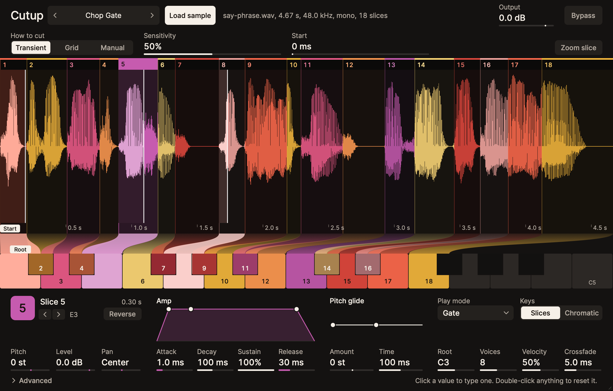

# Cutup

Load a vocal sample, cut it at its transients or on a grid, and play the slices from MIDI. Each slice has its own Pitch, Reverse, Attack, Release, Level and Pan.

How to load it: Audio Units > Luke Garito > Cutup. It is an instrument (`aumu SSlc Luke`), MIDI in, stereo or mono out, no audio in.

With no sample loaded it is silent. That is on purpose, and the one exception to the rule that defaults must make sound.

## Getting a sample in

Press Load, or drag a file onto the window. WAV, AIFF, FLAC, Ogg, MP3, M4A and CAF all work. The file is read on a background thread, and notes keep playing while it loads. A file with more than 2 channels loads as its first 2.

The audio itself is saved in the plug-in state, as 32 bit floats, so a session still works after the file moves. It is not compressed, so that restore is bit exact.

**Size limit:** 64 MB of audio. That is 5.8 minutes mono or 2.9 minutes stereo at 48 kHz. A longer file is refused with a message, and the sample already loaded stays.

## The window

The window is titled Cutup. The build keeps its current name for now.



- The waveform runs edge to edge, cut into coloured slices with numbers on top. Eight warm colours repeat. A colour only ever means a slice: slice 7 is the same colour on the waveform, on its ribbon, on its key, and on the controls that edit it.
- Ribbons carry each slice down to its key. A voice lights up its key and its ribbon, and the part of the slice it has played so far, as bright as that voice is loud.
- Click a slice or a key to select it and hear it. Drag a marker to move it. Double-click to add one. Option-click or right-click to remove one. Any of these turns Slice Mode to Manual.
- Level changes the height of a slice on the waveform, Reverse flips it, and Pitch shows on its number.
- Drag the Start tab under the waveform to set Slice Start. Drag the Root tab above the keys to set Root Note.
- Zoom slice fills the waveform with the selected slice, to place its markers closely. It is a view, and is not saved.
- Load sample, or drop a file anywhere on the window. With nothing loaded, the waveform invites you to.
- The stepper chooses which of the 32 slots the Pitch, Level, Pan, Reverse, Attack and Release controls edit, including slots this sample has not filled. Those are the slot's real parameters.
- Amp and Pitch glide are graphs with dots to drag. Their cells underneath are the same parameters.
- Advanced holds Min Slice, Transpose, Bend Range and the three readings.
- Drag any value, click it to type one, double-click it to reset it. Type 1.5 s or 250 ms for a time, 40 L for a pan, D3 for a root.
- Resize it from the corner. Its size and Advanced are saved with the session, and nothing else is added.

## Controls

Every control is a real AU parameter with a value string. The sample and hand-moved markers are data, not controls, so a host can set everything below but cannot load a file or drag a marker.

### Slicing

| Control | What it does |
|---|---|
| Slice Mode | Transient, Grid or Manual. Manual uses the markers moved by hand. Until something has been moved it starts from the slices on show when you pick it in the window, or the default transient slices if a host sets it |
| Sensitivity | 0 to 100%. How weak an onset can be and still cut. Transient mode |
| Min Slice | 5 to 1000 ms. Two cuts never come closer than this, and the stronger one stays. Transient mode |
| Slice Start | 0 to 60000 ms. Nothing before this point is sliced. Works in Transient and Grid |
| Grid Type | Equal Parts or Note Length |
| Grid | 2, 3, 4, 6, 8, 12, 16, 24 or 32 equal parts, for Equal Parts |
| Grid Note | 1/2 to 1/32, triplets and dotted, for Note Length |
| Grid Tempo | 40 to 300 BPM, for Note Length. Set by hand, so a bounce never depends on the host's tempo |

There are 32 slots. If a sample has more onsets than that, the 32 strongest stay. If a Note Length grid would need more, the last slice runs to the end of the sample.

### Each slice (32 slots, 192 parameters)

Named `Slice 01 Pitch` up to `Slice 32 Pan`.

| Control | What it does |
|---|---|
| Pitch | -24 to +24 semitones, in hundredths. Speeds the slice up or down, like tape |
| Reverse | Plays the slice backwards |
| Attack | 0 to 2000 ms. A linear rise, never shorter than 1 ms |
| Release | 1 to 4000 ms, never shorter than 3 ms. After note off, and also the fade that ends a slice that runs out |
| Level | -60 to +12 dB |
| Pan | -100 to +100%. 0 passes both sides at full level, and each way turns the far side down |

### Playing

| Control | What it does |
|---|---|
| Play Mode | Gate plays while held. One Shot plays to the slice end whatever the note does. Loop repeats while held. To End runs on past the slice to the end of the sample. Boomerang plays forward, then straight back |
| Key Mode | Slices gives each slice its own key, up from Root Note. Chromatic plays the Selected Slice across the keyboard, with Root Note at its own pitch |
| Root Note | The key of slice 1, or the natural pitch key in Chromatic |
| Selected Slice | The slice the window edits and Chromatic plays |
| Polyphony | 1 to 16. Past that, the oldest voice fades out over 5 ms |
| Transpose | -24 to +24 semitones, all slices |
| Bend Range | 0 to 24 semitones for the pitch wheel |
| Pitch Env Amount, Pitch Env Time | Each note starts this many semitones off and glides back to pitch over this time |
| Decay, Sustain | After the Attack, falls to Sustain over the Decay. All slices. Sustain 100% switches it off. Sustain 0% ends the note after its Decay |
| Loop Crossfade | 1 to 500 ms. How much the end of a loop blends into its start. Up to half the slice |
| Velocity Sens | 0 to 100%. 100% makes level follow velocity in a straight line |
| Output | -60 to +12 dB |
| Bypass | Silent, with a 20 ms fade. Latency stays 0 |

It also answers the sustain pedal, All Sound Off and All Notes Off.

### Readings (read only, never automated)

Slices Found, Sample Length, Active Voices.

## Presets

They set behaviours and never touch the sample or hand-moved markers. Choosing one resets the slot Pitch, Pan, Attack, Release and Reverse.

Chop Gate (the defaults), One Shot Stabs, Mono Cut, Stutter Loop, Vowel Hold, Reverse Swell, Boomerang, Keys From One Slice, Pluck Chops, Pitch Drop Chops, Octave Down Run, Fine Transients, Even Eighths, Tempo Sixteenths.

## Signal flow

Background thread: file, cleaned of non-finite samples, onset analysis, waveform overview, then handed over.

Audio thread: MIDI, voice, band limited read from the sample at the pitch's speed, Attack and Decay, Release or steal fade or slice end fade, Level and velocity, Pan, sum of voices, Output, Bypass fade.

Latency is 0 at every sample rate.

## How swapping stays real time safe

A new sample is built off the audio thread and handed over through one atomic pointer. The audio thread fades the voices on the old sample over 5 ms and starts using the new one. When no voice reads the old sample any more, it passes it back through a lock-free queue, and the background thread frees it. The audio thread never allocates, frees or waits on a lock. Hand edits to markers arrive through a try-lock that it skips if busy and retries next block.

## Damaged state

A saved session is outside input, so everything is checked on load: sizes, sample rate, channels, frame count, marker order and bounds, onset lists, a hash of the audio, and every audio value finite and within +/-16. If the sample part fails it loads empty with a message in the window, and the plug-in stays usable. If the whole state is unreadable or over the size limit, the controls go back to their defaults too.

## What was measured

All numbers are in `tests/results.txt` and `tests/au-check.txt`. Limits were written before the first run. Where one was changed, the test says why.

- Transient slicing on a generated file with 14 known onsets: worst 2.0 ms across 44.1, 48 and 96 kHz (limit 5 ms)
- Transient slicing on macOS `say`, 26 words joined with known gaps: worst 2.1 ms, mean 0.3 ms, and no cut after the word starts (limit 5 ms). 6 of the words were not run until the limit was set
- With noise 60 dB under the speech: worst 5.3 ms early on one soft F, 0.05 ms at the latest (limits 10 ms early, 5 ms late, see the test)
- Grid slicing exact on a prime length for all 9 grids, and exact for 11 note lengths at 3 tempos
- MIDI: each of 8 notes plays its own slice, and notes outside are silent. Notes start on their own sample
- Pitch: within 5 cents from -24 to +24 semitones, also for a 44.1 kHz file at each host rate
- Reverse and Boomerang: within 0.000001 of the exact reverse
- Attack and Release: within 20% at 5 to 2000 ms at each host rate. On a constant file they measure within 0.1 ms at 48 kHz
- Level: within 0.2 dB from -24 to +12 dB. Pan, Decay, Sustain, Loop Crossfade, Velocity Sens and Output each have a measured number
- Polyphony 1 to 16: the right number sound, the oldest go, no step above the sum's own slope. 400 notes in one block stay finite
- Slice ends: no step above 1.3 times the tone's own slope in Gate, One Shot, Reverse, pitched, To End and Loop. 2 ms slices stay clean
- State: save and restore nulls to exactly 0 in all three Slice Modes, with the file moved away, and saves back byte for byte. The real installed component does the same
- Damaged state: about 50 kinds of named damage, 17 cut lengths, 100 blocks of noise and 400 randomly damaged states, none unsafe
- Swap: the block that takes a new sample allocates nothing, does not click, and the old sample is freed off the audio thread
- Window: created and destroyed 90 more times, 60 of them with a real audio thread running and a file loading, clicks, drags, double clicks and drops driven offline
- Window reaches every parameter: `tests/WindowTests.h` clicks its way to each of the 218 by mouse at the smallest size, with no sample and with one. It steps through all 32 slots, drags each cell, and checks that it moves that parameter and no other slot's, with one begin and one end gesture, and that a double-click resets it. Taking one control out makes the test fail, which was tried
- Sound with the window: all 14 presets bit identical to 1.0.0, with the window closed and with it open and drawing throughout
- Loading through the window: no block allocates, and a held note never goes silent, until the new sample takes over
- Window CPU, real window at 2x with notes playing: 1.4 to 3.4% of one core over 10 runs, median 1.8%. The 3.4% run landed mostly on slow cores; the work stayed at 1.0% of a fast core in all 10. 16 voices looping at once: 3.8% over 3 runs. Silent: 0.6% over 3 runs, with almost no redraws. Other agents were building during these, at a load of about 4 to 5
- Pitching a 15 kHz tone up an octave: fold back at -94 dB. Pitching a 5 kHz tone down an octave: image at 21.5 kHz at -102 dB

Tones, noise and a synthetic voice do not prove it sounds good on a real singer. Slicing a real vocal with breaths, reverb and bleed needs ears. Nothing has been loaded in Logic.

## Building

```
cmake -S . -B build -DCMAKE_BUILD_TYPE=Release
cmake --build build --target PluginTest -j 1
build/PluginTest_artefacts/Release/PluginTest | tee tests/results.txt
cmake --build build --target InstallAU -j 1
auval -v aumu SSlc Luke
```

The check against the real component:

```
SMOOTH_SLICE_WRITE_STATE=build/austate.bin build/PluginTest_artefacts/Release/PluginTest > /dev/null
clang++ -std=c++17 -O2 tests/AUStateCheck.cpp -framework AudioToolbox -framework CoreFoundation -o build/AUStateCheck
build/AUStateCheck build/austate.bin | tee tests/au-check.txt
```

The window's pictures and CPU, with speech from macOS `say` loaded through the real load path (`tests/make_corpus.sh` remakes it):

```
cmake --build build --target RenderWindow -j 1
build/RenderWindow_artefacts/Release/RenderWindow docs/window
build/RenderWindow_artefacts/Release/RenderWindow --live 5 8
build/RenderWindow_artefacts/Release/RenderWindow --live 3 8 dense
build/RenderWindow_artefacts/Release/RenderWindow --live 3 6 silent
```

Inter (SIL Open Font License, `assets/fonts/OFL.txt`) is the window's font.
